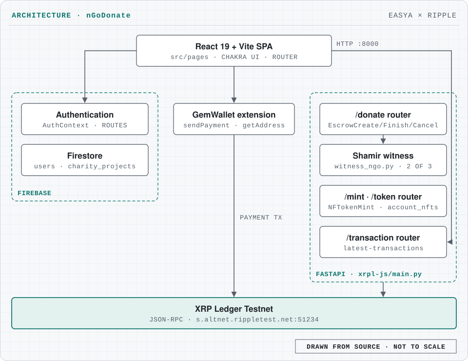

# nGoDonate

XRP Ledger donation platform with milestone-based escrow payments and NFT donation receipts, built with FastAPI and React; Winner, Best Developer Tooling, EasyA x Ripple hackathon.

[](https://xrpl.org/)
[](https://fastapi.tiangolo.com/)
[](https://react.dev/)
[](#)


Live site: https://easya-hackathon-tawny.vercel.app

Demo video: [Google Drive folder](https://drive.google.com/drive/folders/1AhDhGtqxIBAe7raqtm7aah3fBNZaKPHf?usp=sharing) (open it in a normal browser tab, not incognito).

## What it does

nGoDonate is a blockchain-based, near-transparent, trustworthy and secure donation platform. NGOs list charity projects; donors sign in, browse projects and donate in XRP from their GemWallet browser wallet. Each project page lists the latest transactions on the NGO's XRP Ledger Testnet account.

- 🌐 **React + Vite** for a fast and modern frontend experience
- ⚙️ **FastAPI** for a high-performance backend API in Python
- 🔗 **XRP Ledger (XRPL)** for blockchain interactions (sending transactions, checking balances, etc.)

### XRP Ledger integration

The backend uses `xrpl-py` to interact with the XRP Ledger.

| Feature | Purpose |
|---|---|
| **Mint NFTs** | Mints a new NFT on the XRP Ledger using the provided metadata and wallet seed. |
| **Fetch NFTs** | Retrieves all NFTs associated with a specified XRP Ledger account. |
| **Create Escrow Donations** | Creates time-locked escrow payments linked to milestone deadlines for secure, conditional donations. |
| **Verify Milestones** | Verifies milestone completion and either releases or cancels escrowed funds accordingly. |

## Architecture

<picture>
  <source media="(prefers-color-scheme: dark)" srcset="docs/architecture-dark.svg">
  
</picture>

- **Front end** ([src/](src)). A React 19 + Vite single-page app with Chakra UI and React Router. Pages cover sign-up and login, creating a charity project, a project page, a donation page, NFT minting and the user profile.
- **Firebase.** Authentication backs `AuthContext` and the protected routes; Firestore stores `users` and `charity_projects`. Configuration comes from `VITE_FIREBASE_*` variables ([src/firebase/config.js](src/firebase/config.js)).
- **Payments.** The donation page sends an XRP payment with GemWallet's `sendPayment`, signed in the donor's browser wallet; sign-up reads the wallet address with `getAddress`.
- **API** ([xrpl-js/](xrpl-js)). A FastAPI app with three routers. `/donate` creates one time-locked escrow per milestone and, on verification, finishes or cancels it after a Shamir 2-of-3 secret check ([services/witness_ngo.py](xrpl-js/services/witness_ngo.py)). The NFT router mints with `NFTokenMint` and lists an account's NFTs. `/transaction/latest-transactions` returns the NGO account's latest transactions, which the project page polls.
- **Ledger.** Everything runs on the XRP Ledger Testnet through the JSON-RPC endpoint `s.altnet.rippletest.net:51234`.

## Tech stack

| Layer | Tools |
|---|---|
| Front end | React 19, Vite 6, Chakra UI 3, React Router 7, Framer Motion |
| Wallet | GemWallet (`@gemwallet/api`) |
| Auth and data | Firebase Authentication, Cloud Firestore, Firebase Analytics |
| API | FastAPI, Uvicorn, Pydantic |
| Ledger | XRP Ledger Testnet, `xrpl-py` |

## Getting started

### 1. Clone the repository

```bash
git clone https://github.com/Unknown-Blaze/easya-hackathon.git
cd easya-hackathon
```

### 2. Backend setup (FastAPI)

The API lives in [xrpl-js/](xrpl-js).

```bash
cd xrpl-js
python -m venv venv
source venv/bin/activate  # On Windows: venv\Scripts\activate
pip install -r requirements.txt
pip install -e .
uvicorn main:app --reload
```

Default API URL: `http://localhost:8000` (interactive docs at `/docs`). The API needs no environment variables; it talks to the public XRPL Testnet.

[xrpl-js/requirements.txt](xrpl-js/requirements.txt):

```text
fastapi
uvicorn
xrpl-py
python-dotenv
firebase-admin
pydantic
email-validator
web3
sympy
```

### 3. Frontend setup (React + Vite)

The front end is at the repository root. Create a `.env` file there with your Firebase web app settings:

```text
VITE_FIREBASE_API_KEY
VITE_FIREBASE_AUTH_DOMAIN
VITE_FIREBASE_PROJECT_ID
VITE_FIREBASE_STORAGE_BUCKET
VITE_FIREBASE_MESSAGING_SENDER_ID
VITE_FIREBASE_APP_ID
VITE_FIREBASE_MEASUREMENT_ID
```

```bash
npm install
npm run dev
```

Frontend runs on: `http://localhost:5173`. To donate you need the [GemWallet](https://gemwallet.app/) browser extension on a Testnet account. The project page expects the API at `http://127.0.0.1:8000`.

### XRP donation API endpoints

The routers are mounted under prefixes in [xrpl-js/main.py](xrpl-js/main.py); the NFT router is mounted at both `/mint` and `/token`.

| Endpoint | Method | Description |
|---|---|---|
| `/donate/donate` | POST | Accept a donation: create one time-locked XRP escrow per milestone |
| `/donate/verify` | POST | Verify a milestone, then release (EscrowFinish) or cancel (EscrowCancel) the escrow |
| `/mint/mint` | POST | Mint a token (NFT) with `NFTokenMint` |
| `/mint/token` | GET | Retrieve the NFTs held by an account |
| `/transaction/latest-transactions` | GET | Get a list of the latest donation transactions |

Block explorer link: https://testnet.xrpl.org/accounts/r4sXNGwP85VZ4PQbceXD66Xp8cJHL6mT9B

## Project structure

```text
.
├── index.html, vite.config.js, package.json   # Vite front end at the root
├── src/
│   ├── pages/          # sign-up, login, projects, donation, mint NFT, profile
│   ├── components/     # landing page, protected routes
│   ├── contexts/       # AuthContext
│   ├── firebase/       # Firebase config (VITE_FIREBASE_*)
│   └── services/       # Firestore helpers, transaction polling
├── xrpl-js/            # FastAPI backend
│   ├── main.py
│   ├── routers/        # donate, nft, transaction, wallet (disabled)
│   └── services/       # XRPL client, Shamir witness
├── public/             # images
└── screenshots/
```

## Screenshots


